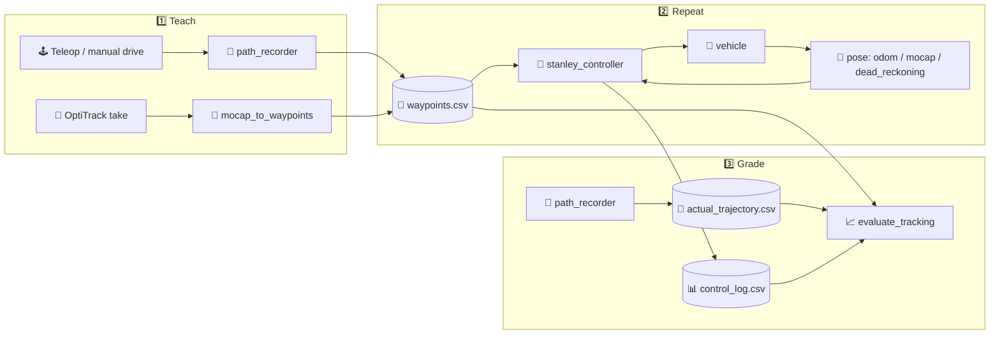

# 🏎️ `stanley_controller` — Follow the Path, Stanley Style!

> *"Drive it once by hand 🕹️, let the robot drive it forever 🤖."*

A ROS 2 (`ament_python`) package that makes a car **record a path while you drive it, then follow that path on its own**. It pairs two controllers:

- 🧭 a **Stanley lateral controller** (the steering method behind *Stanley*, the Stanford car that won the 2005 DARPA Grand Challenge 🏆), and
- 🎚️ a **PID longitudinal speed controller** with anti-windup, derivative-on-measurement and optional feed-forward.

The same code drives **three platforms**:

| Platform | Pose from | Commands sent as |
|---|---|---|
| 🚙 **Toyota Prius** in Gazebo (`prius_bringup`) | `/odom` | `geometry_msgs/Twist` |
| 🚗 **Quanser QCar** in Gazebo (`qcar_gazebo`) | `/qcar_sim/odom` | `Vector3Stamped` (speed, steering) |
| 🏁 **Physical QCar 2** | OptiTrack mocap 🎥, dead reckoning 🧮 or IMU odometry 🌀 | `qcar2_interfaces/MotorCommands` or `Vector3Stamped` |

---

## 🗺️ The Big Picture



1. **Teach 🧑‍🏫** — drive the car by hand while `path_recorder` drops a waypoint every ~15–20 cm (or convert an OptiTrack take with `mocap_to_waypoints`).
2. **Repeat 🔁** — `stanley_controller` loads those waypoints and steers + throttles the car along them, slowing down automatically in curves.
3. **Grade 🎓** — record what the car actually did and let `evaluate_tracking` compute cross-track errors (straights vs. curves) and draw comparison plots.

---

## 🧠 How the Control Works

### 🧭 Lateral: Stanley

Evaluated at the **front axle** (the odometry pose is projected forward by `front_axle_offset`):

```
δ = θₑ − atan2(k · e_ct, k_s + |v|)        then clipped to ±max_steering_angle
```

| Symbol | Meaning |
|---|---|
| `θₑ` | heading error = path heading − vehicle yaw, wrapped to [−π, π] |
| `e_ct` | signed cross-track error, **positive when the front axle is LEFT of the path** |
| `k` | `stanley_gain` — how aggressively to correct lateral drift |
| `k_s` | `softening_gain` — keeps the term sane at low speed |

The minus sign follows from ROS conventions (REP‑103: `δ > 0` turns left), so being left of the path steers you right ↩️. The nearest segment is searched only within a forward `search_window`, so loops that pass near their start never confuse the controller 🔄.

### 🎚️ Longitudinal: PID

```
u = K_ff·v_ref + K_p·e + K_i·∫e dt + K_d·(−dv/dt, low-pass filtered)
```

- 🛑 **Clamped** to `[min_command, max_command]`
- 🧯 **Double anti-windup**: the integral is bounded by `integral_limit` *and* frozen while the output is saturated
- 🦵 **No derivative kick** when `v_ref` jumps between straight and curve speed
- 🐢 **Curve-aware speed**: segments whose curvature exceeds `curve_curvature_threshold` use `target_speed_curve` instead of `target_speed`

### 🛡️ Safety

- ⏱️ Stale pose or speed for longer than `odom_timeout` → the car is held at zero
- 🏁 Goal reached → keeps publishing stop commands (real cars may latch the last one)
- 🔌 Ctrl+C / SIGTERM → sends a final stop **three times** before shutting down
- 👀 Warns if another node (e.g. a forgotten teleop) is publishing on the same command topic
- 🎛️ Gains can be **tuned live** with `ros2 param set /stanley_controller stanley_gain 0.8`, no restart needed

---

## 📦 Executables

| Executable | Kind | What it does |
|---|---|---|
| `stanley_controller` | 🤖 node | Stanley + PID path follower |
| `path_recorder` | 🤖 node | Records odometry (optionally projected to the front axle) into a waypoints CSV |
| `dead_reckoning` | 🤖 node | Estimates the real QCar pose from the tachometer + steering command or IMU gyro |
| `qcar_teleop_bridge` | 🤖 node | Turns `teleop_twist_keyboard` `/cmd_vel` into QCar sim commands |
| `mocap_to_waypoints` | 🛠️ CLI | Converts an OptiTrack Motive CSV take into a waypoints file |
| `evaluate_tracking` | 📈 CLI | Computes tracking error and saves overlay and control-signal plots |

---

## 🛠️ Build

```bash
cd ~/Workspaces/smart_movility_ws
colcon build --packages-select stanley_controller
source install/setup.bash
```

**Dependencies** 🔗: `rclpy`, `nav_msgs`, `geometry_msgs`, `sensor_msgs`, `rcl_interfaces`, `qcar2_interfaces`, plus `prius_bringup` / `qcar_gazebo` for simulation and `python3-numpy`, `python3-matplotlib`, `python3-yaml`.

> ⚠️ **Heads-up:** the YAML files in [`config/`](config/) use absolute paths under `/home/nombre_usuario/`. Change `path_file`, `output_file` and `log_file` to match your machine, or pass your own file with `params_file:=...`.

---

## 🚀 Quick Start Recipes

### 🚙 Recipe A — Prius in Gazebo

```bash
# 1️⃣ Teach: start the sim, drive with teleop, record (Ctrl+C saves the file)
ros2 launch prius_bringup gz_sim.launch.py
ros2 launch stanley_controller record_path.launch.py

# 2️⃣ Repeat: starts the sim + controller (waits 5 s for Gazebo)
ros2 launch stanley_controller stanley_controller.launch.py
#    …and in another terminal, record what actually happened
ros2 launch stanley_controller record_actual_trajectory.launch.py

# 3️⃣ Grade
ros2 run stanley_controller evaluate_tracking
```

### 🚗 Recipe B — QCar in Gazebo

```bash
# 1️⃣ Teach (keyboard bridge included; keyboard_bridge:=false for a joystick)
ros2 launch qcar_gazebo gz_sim.launch.py
ros2 launch stanley_controller qcar_record_path.launch.py
ros2 run teleop_twist_keyboard teleop_twist_keyboard

# 2️⃣ Repeat — ⚠️ stop the teleop bridge first, otherwise it overrides Stanley!
ros2 launch stanley_controller qcar_stanley_controller.launch.py world:=test_world.sdf
ros2 launch stanley_controller qcar_record_actual_trajectory.launch.py

# 3️⃣ Grade
ros2 run stanley_controller evaluate_tracking \
  --reference ~/qcar_stanley_waypoints.csv \
  --actual    ~/qcar_stanley_actual_trajectory.csv \
  --log       ~/qcar_stanley_control_log.csv \
  --curve-curvature-threshold 1.0
```

### 🏁 Recipe C — Real QCar 2 + OptiTrack

```bash
# 1️⃣ Teach: export the reference run from Motive as CSV, then convert it
ros2 run stanley_controller mocap_to_waypoints --input "$HOME/Qcar_Red_Take 001.csv"
#    → prints the yaw offset to copy into qcar_real_mocap_params.yaml 📋

# 2️⃣ Repeat with a live mocap pose…
ros2 launch stanley_controller qcar_real_stanley.launch.py pose_source:=mocap
#    …or without cameras, using dead reckoning (place the car at the path start!)
ros2 launch stanley_controller qcar_real_stanley.launch.py pose_source:=dead_reckoning

# 3️⃣ Grade from the control log (it contains x_front, y_front)
ros2 run stanley_controller evaluate_tracking \
  --reference ~/qcar_real_waypoints.csv --actual ~/qcar_real_control_log.csv \
  --log ~/qcar_real_control_log.csv
```

### 🌀 Recipe D — Real QCar 2 + IMU Odometry

```bash
# Waypoints come from an IMU bag (~/waypoints.csv, made by an external bag_to_waypoints.py)
# Put the car where the bag started and keep it STILL for 3 s while the gyro bias is estimated 🧘
ros2 launch stanley_controller qcar_imu_stanley.launch.py
ros2 launch stanley_controller qcar_imu_record_actual_trajectory.launch.py
```

> 🐢 This setup runs slowly on purpose (≈0.12 m/s): the car reacts to commands about 2 s late, and at higher speeds Stanley starts to oscillate.

---

## 📄 File Formats

**Waypoints CSV** (`path_recorder`, `mocap_to_waypoints`)
```
x, y, yaw, linear_velocity, angular_velocity[, ref_x, ref_y, t]
```
Only `x, y` are needed for tracking (`yaw` too if `path_front_axle_offset > 0`). `ref_x, ref_y` give `dead_reckoning` its starting pose.

**Control log CSV** (`log_file` parameter)
```
t, x_front, y_front, v_ref, v, u, delta, cross_track_error, heading_error
```

---

## 📁 Package Layout

| Folder | Contents |
|---|---|
| 📂 [`stanley_controller/`](stanley_controller/) | Python source: nodes, controllers, geometry and mocap helpers |
| 🚀 [`launch/`](launch/) | Launch files for recording, tracking and real-car runs |
| ⚙️ [`config/`](config/) | Parameter YAMLs for each platform and step |
| 🧪 [`test/`](test/) | Unit tests + flake8 / pep257 linters |
| 🏷️ [`resource/`](resource/) | ament index marker file |

---

## 🧪 Tests

```bash
colcon test --packages-select stanley_controller
colcon test-result --verbose
```

---

## 📜 License

Apache License 2.0 — see [`LICENSE`](LICENSE). Happy (autonomous) driving! 🏁✨
